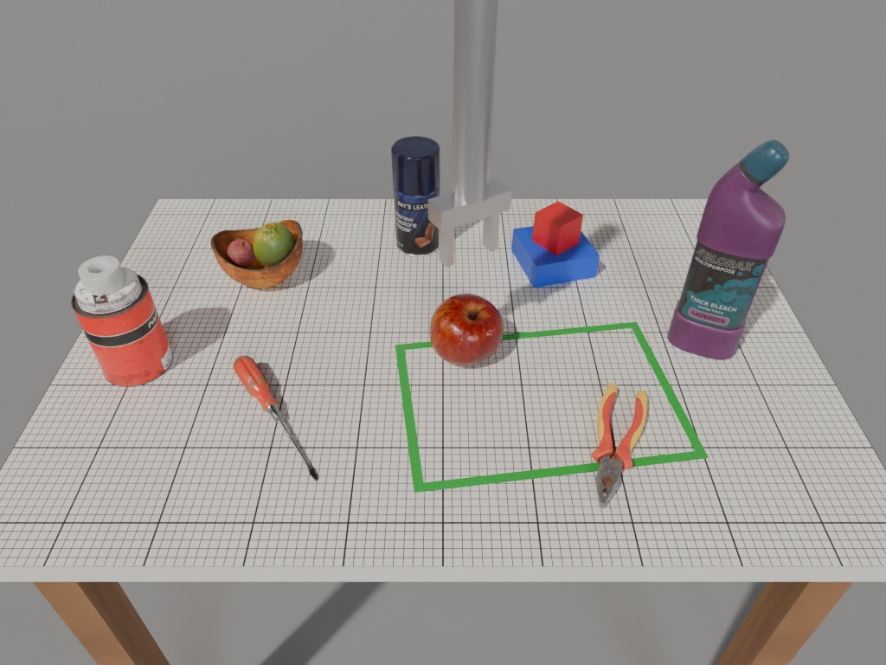
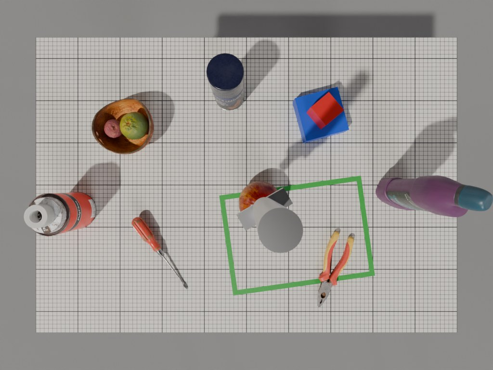
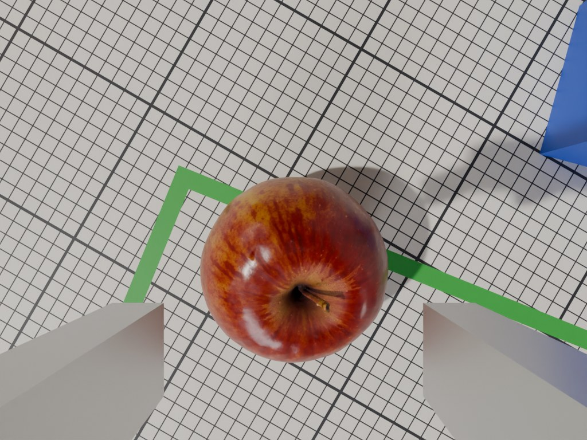
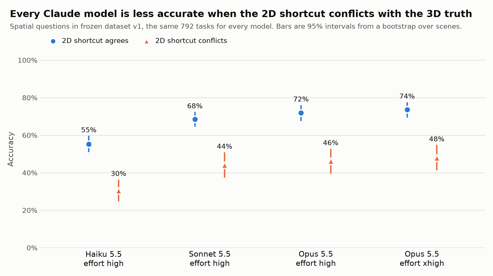
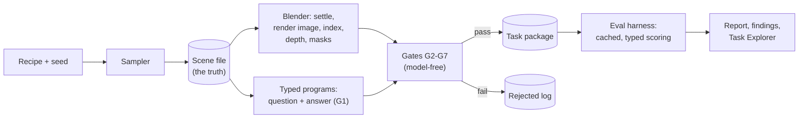

# Visual Task Factory: spatial questions a robot must get right

A factory that keeps producing new visual tasks for robot perception, each with an answer that is proved, not guessed. It builds photoreal 3D tabletop scenes in Blender, looks at them through a robot's front, overhead and gripper cameras, asks the questions a robot needs answered exactly (what is nearest the gripper, what is in front of what, what is hidden, what sits on or inside what, what is inside the reach zone, how many), computes every answer with a program run on the 3D scene file, checks it with eight model-free gates, and then measures where frontier vision models break.

Built for the Innodata AI Hackathon, Visual Task Factory track. No AI model writes or checks an answer, and no AI image generator is anywhere in the image path.

| Front camera | Overhead camera | Gripper camera |
| --- | --- | --- |
|  |  |  |

## Headline finding



On frozen dataset v1, every Claude model we tested loses about 25 points when the answer a flat 2D reading of the image suggests (the object that looks nearest, or lowest in the frame) differs from the 3D truth:

- Shortcut agrees vs conflicts: Haiku 5.5 high 55% vs 30%, Sonnet 5.5 high 68% vs 44%, Opus 5.5 high 72% vs 46%, Opus 5.5 xhigh 74% vs 48% (the same 558 and 234 spatial tasks for every model; 95% intervals from a bootstrap over scenes).
- The gap survives controls: inside the same family and camera, conflict tasks score 25 to 28 points lower; a logistic regression holding visible fraction, near-tie margin, object count, camera quality and family fixed gives conflict odds ratios of 0.22 to 0.29.
- More thinking does not close it: Opus 5.5 at xhigh effort thinks about twice as long on conflict tasks as at high, and the gap moves by 0 points (-5 to +5). Larger models raise conflict accuracy (Haiku to Opus +16 points) but not the gap.
- When Sonnet and Opus get a conflict task wrong, 64 to 68% of their wrong answers are exactly the 2D-shortcut answer, 1.4 to 1.5 times chance; on "which object is closest to the gripper", 22 of Opus xhigh's 27 misses name the object nearest in the image.

Why it matters: a robot that trusts the 2D impression grasps the wrong object or reaches into the wrong place. Full analysis: [docs/reports/v1/findings.md](docs/reports/v1/findings.md).

Supporting findings: breaking-point curves and counterfactual twins (see [findings.md](docs/reports/v1/findings.md)).

## See it

- **Task Explorer:** [vtf-task-explorer.vercel.app](https://vtf-task-explorer.vercel.app). Rotate the 3D scene, switch cameras, read each question with its true answer and every model's answer. The [conflict gallery](https://vtf-task-explorer.vercel.app/?view=gallery) shows 12 scenes where every model took the shortcut, with the true object in blue and the shortcut object in orange.
- **Dataset report:** [docs/reports/v1/index.html](docs/reports/v1/index.html) (download and open in a browser): gate pass rates, rejection reasons, coverage by family, camera and difficulty, answer distributions, model accuracy.
- **Dataset on Hugging Face:** [Hrishi1802/hrishikesh-visual-task-factory](https://huggingface.co/datasets/Hrishi1802/hrishikesh-visual-task-factory): 3,181 tasks with images, scene files, masks, depth, every gate's evidence and every model answer.
- **How it was validated:** [docs/VALIDATION.md](docs/VALIDATION.md). **How models were run and scored:** [docs/EVAL_PROTOCOL.md](docs/EVAL_PROTOCOL.md). **How it is built:** [docs/ARCHITECTURE.md](docs/ARCHITECTURE.md).

## Dataset v1 in numbers

300 scenes rendered from `recipes/v1.yaml` with seed 1; 261 passed the physics settle check and validation; 7,013 candidate questions; **3,181 tasks shipped** in 12 families from 3 cameras (front 1,253, overhead 1,235, gripper 693), including 484 counterfactual twins. 424 are spatial tasks where the 2D shortcut conflicts with the 3D truth. Every rejection is logged with its reason. Scenes have 3 to 25 of 44 everyday objects (40 Poly Haven CC0 models and 4 procedural scale references), stacks, containers, reach zones, look-alikes, four lighting conditions and four camera-quality levels from clean to CCTV.

## How it works



| Gate | Proves |
| --- | --- |
| G1 Truth by execution | The answer is the program's output on the settled 3D scene |
| G2 Second computation | Recomputed from rendered pixels (object index and depth), it agrees |
| G3 Evidence visible | Every object the question needs is visible enough; a scale reference is in view for centimetre questions |
| G4 No near-ties | Exactly one right answer, by metric and pixel margins |
| G5 Vision necessity | Balanced answers; prior-only and question-only baselines stay far below models with the image |
| G6 Counterfactual twin | Move one object, re-render: the answer changes |
| G7 Determinism | Same seed, same scene file, masks, depth and answer, byte for byte |
| G8 Physical twin | Real objects placed by a generated layout and photographed (in progress) |

## Quickstart

Needs [uv](https://docs.astral.sh/uv/) and Blender 5.3 (`brew install --cask blender` on macOS; on Linux put `blender` on the PATH or set `VTF_BLENDER`). No API key needed.

```bash
git clone https://github.com/Zugzwang-world/hrishikesh-visual-task-factory.git
cd hrishikesh-visual-task-factory
uv sync
uv run vtf quickstart
```

One command runs the whole factory on [recipes/quick.yaml](recipes/quick.yaml): it fetches 13 CC0 models and one HDRI from Poly Haven (about 18 MB, first run only), samples 7 scenes from seed 1, renders 21 images in Blender with masks and depth, compiles and gates the questions, renders G6 twins, packages the tasks, evaluates them, and writes a report. Without a key it evaluates with `fake-oracle`, which must score 100% (a check of the scorer); with `ANTHROPIC_API_KEY` in `.env` it also runs Claude Sonnet 5.5 on a 20-task sample (about $0.09). About 5 minutes on an Apple M4 (GPU), 1.5 of them the one-time download; [docs/reports/quickstart_check.md](docs/reports/quickstart_check.md) records a timed run from a fresh clone.

Then look at `out/quick/report/index.html`, `out/quick/report/contact_sheet.png`, a task in `out/quick/tasks/<task_id>/task.json`, and the rejection log `out/quick/rejected.jsonl`.

Check repeatability: re-sample two scenes from the seed, re-render them, re-run every question, compare every hash.

```bash
uv run vtf verify out/quick --sample 2
```

Expect `truth ALL MATCH` (scene files, settled scenes, object index, depth, masks, answers and G7 hashes exact) and a line with the beauty images' SSIM: GPU re-renders come back at about 0.998 to 0.9999, not byte for byte (Metal path tracing plus the denoiser).

Verify the published dataset itself, from the Hugging Face release (results: [docs/reports/v1/verify_showcase.md](docs/reports/v1/verify_showcase.md)):

```bash
hf download Hrishi1802/hrishikesh-visual-task-factory --repo-type dataset --local-dir out/v1
uv run python assets/fetch_manifest.py      # all 40 CC0 models used by v1 (about 60 MB)
uv run vtf verify-showcase out/v1           # 3 scenes on GPU and twice on CPU, plus the first batch replayed
```

The full pipeline step by step, a scale run and the evaluation commands are in [docs/ARCHITECTURE.md](docs/ARCHITECTURE.md#commands).

## Repository

| Path | What it holds |
| --- | --- |
| `packages/vtf/` | Core package and the `vtf` CLI: contracts, sampler, question programs, gates, packaging, eval harness. Never imports `bpy` |
| `packages/vtf-blender/` | Code that runs inside Blender (build, rigid-body settle, render passes); talks to the core only through files |
| `spec/` | Versioned JSON Schemas (scene, render manifest, task package, asset manifest) and the family rules in `families.md` |
| `recipes/` | YAML recipes: `v1.yaml` (the dataset), `quick.yaml` (the quickstart) |
| `assets/manifest.yaml` | 44 objects with real sizes, colours and container interiors |
| `configs/models.yaml` | Model settings for the eval harness |
| `docs/` | Validation, eval protocol, architecture, reports and findings |
| `web/` | Task Explorer (Next.js and three.js) |
| `tests/` | `uv run pytest` |

Limits, stated plainly: only Claude models have been evaluated so far; the founder's blind audit and the physical-twin photos (G8) are still being done. Re-rendered images are near-exact, not byte-identical: SSIM 0.998 or above on the GPU, and two CPU renders differ by a few colour levels in under 0.01% of pixels. `vtf verify` also caught a renderer bug: in v1, an object already drawn by an earlier scene in the same Blender process kept the simplified material of that scene's 3D-viewer export, which can affect 248 of 261 scenes (answers, masks and depth unaffected; see [verify_showcase.md](docs/reports/v1/verify_showcase.md)).
