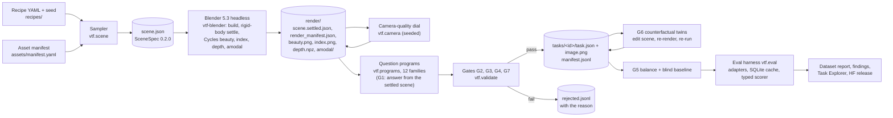

# Architecture

The scene file is the truth. A seeded sampler writes a renderer-independent JSON world state; Blender draws it; typed programs ask questions of it and compute the answers from it; model-free gates check the image against the state; only tasks that pass every gate are packaged and evaluated. No model ever writes an answer, and no AI image generator is anywhere in the image path.



## Packs and engine

A domain pack is everything that knows what a workcell is; the engine is everything that does not. Today there is one pack, the robot workcell, and the boundary is a folder boundary rather than a plugin API.

| Pack (domain words live here) | Engine (no domain words) |
| --- | --- |
| `recipes/*.yaml`: clutter, stacks, containers, zones, cameras, lighting, question mix | `vtf.core`: pydantic contracts, seeded RNG, hashing, file IO, run layout, mesh ray caster |
| `assets/manifest.yaml`: 44 objects (40 Poly Haven CC0 models, 4 procedural scale references) with real sizes, colours, container interiors | `vtf.render.bridge`: runs Blender as a subprocess on a job list, watchdog per scene, failure log |
| `vtf.scene.sampler_v1`: placement under constraints | `vtf.validate`: pipeline, gates, rejection log, collect, scale run, verify |
| `vtf.programs`: the 12 question families, their templates, naming rule and twin rules | `vtf.package`: task writer, audit page, contact sheet, Explorer export |
| `spec/families.md`: the truth rule, pixel route, margins, shortcut heuristic and twin rule per family | `vtf.eval`: adapters, cache, batches, prompts per answer type, scorer, summaries |

A new domain (say a warehouse shelf) would bring its own recipe, manifest, sampler and programs and reuse the rest.

## Contracts

Formats are versioned and generated from the pydantic models (`uv run python -m vtf.core.schemas`); a test fails when a schema goes stale.

| Contract | File | What it holds |
| --- | --- | --- |
| SceneSpec 0.2.0 | [spec/scene.schema.json](../spec/scene.schema.json) | Table, every object (asset, pose, scale, material), stacks and containers, gripper, zones, cameras with camera quality, lighting, render and physics settings, seed, recipe hash |
| RenderManifest 0.2.0 | [spec/render_manifest.schema.json](../spec/render_manifest.schema.json) | Per camera: beauty, 16-bit object index, planar depth in metres, amodal masks, K and world-to-camera (OpenCV convention), dial parameters; settle report; timings |
| TaskPackage 0.2.0 | [spec/task_package.schema.json](../spec/task_package.schema.json) | Image, question, program and parameters, typed answer, tolerance, evidence objects, every gate's result and evidence, shortcut_conflict, versions |
| AssetManifest 0.1.0 | [spec/asset_manifest.schema.json](../spec/asset_manifest.schema.json) | Object ids, sources, real sizes, collision, container interiors |
| Family semantics | [spec/families.md](../spec/families.md) | The rules both answer routes (G1 and G2) are built against |

Run folders follow one layout (`packages/vtf/src/vtf/core/layout.py`): `run.json`, `scenes/<id>/scene.json`, `scenes/<id>/render/`, `tasks/<task_id>/`, `twins/`, `manifest.jsonl`, `rejected.jsonl`, `validate_report.json`, `eval/<model>/`.

## Determinism

- Every random draw comes from `derive_seed(run seed, purpose, ...)`, a sha256 of the parts, so scenes, question choice, twin sampling, the camera dial's noise and every eval sample are pure functions of the seed.
- A task ID is a content hash of the scene file hash, camera, template, question, program, answer and code versions (`vtf.package.writer.make_task_id`). The eval cache is keyed by task ID, model key and prompt version, so a rerun reuses every reply.
- `vtf` never imports `bpy`. Blender runs as a separate process and talks to the core only through files: scene JSON in; images, masks, depth and the settled scene out. The settled poses are written back to `scene.settled.json`, and every answer is computed from that file.
- Rule C, measured on frozen v1 in [docs/reports/v1/verify_showcase.md](reports/v1/verify_showcase.md): scene files, settled scenes, answers, G7 hashes, masks and depth are exact on every re-render; beauty images are near-exact (GPU SSIM 0.998 or above; two CPU renders differ by a few colour levels in under 0.01% of pixels). A beauty image also depends on the scenes rendered before it in the same Blender process (the scene.glb export changes cached asset materials in place), so reproducing a v1 image means replaying its render batch.

## Where each gate sits

| Gate | Module | Runs | Evidence in task.json |
| --- | --- | --- | --- |
| Compile checks | `vtf.programs` | Before any gate: unnameable objects, no candidate, near ties, hidden evidence, zone out of frame | Rejection reason in rejected.jsonl |
| G1 Truth by execution | `validate/gates/g1_truth.py` | Every question: the typed program re-runs on the settled scene | Program, trace, answer |
| G2 Second computation | `g2_second_computation.py` | Every question: the answer recomputed from the index and depth pixels, back-projected through the dial's exact inverse | Both values |
| G3 Evidence visible | `g3_evidence_visible.py` | Every question: visible fraction and pixels of every evidence object; scale in frame for cm questions | Visible fractions, pixel counts |
| G4 No near-ties | `g4_no_near_ties.py` | Every question: metric and pixel margins per family | Margins, runner-up |
| G7 Determinism | `g7_determinism.py` | Every question: hashes of scene, settled scene, index, depth and answer; scene re-sampled from the seed | Hashes |
| G6 Counterfactual twin | `g6_counterfactual_twin.py` | A seeded 20% sample per family x rig: edit the scene by the family's twin rule, re-render, re-run G1 to G4; the answer must change | Twin ID, both answers |
| G5 Vision necessity | `validate/balance.py`, `g5_vision_necessity.py` | After validation: answer distributions capped per family; prior-only and question-only (no image) baselines | Balance report, blind accuracy per family |
| G8 Physical twin | `g8_physical_twin.py`, `vtf.twin` | Photos of real objects placed on the printed mat; ArUco corners map the layout onto the photo | Photo-to-layout transform |

The gate numbers, the rejection funnel and the baselines for v1 are in [VALIDATION.md](VALIDATION.md); prompts, scoring and model settings in [EVAL_PROTOCOL.md](EVAL_PROTOCOL.md).

## Commands

```bash
uv run vtf quickstart                    # everything below on recipes/quick.yaml, one command
uv run vtf generate --recipe recipes/v1.yaml --n 20 --seed 1 --out out/v1dev
uv run vtf render out/v1dev              # Blender, GPU by default (--device cpu for byte-identical images)
uv run vtf validate out/v1dev            # programs, G1-G4, G7, G6 twins, tasks/, manifest, rejected
uv run vtf balance out/v1dev             # G5 answer balance and prior baseline
uv run vtf baseline out/v1dev            # G5 question-only baseline
uv run vtf eval out/v1dev --model claude-sonnet-5-5 --sample 100
uv run vtf dataset-report out/v1dev      # static HTML report
uv run vtf verify out/v1dev --sample 5 --device cpu
uv run vtf run --recipe recipes/v1.yaml --n 500 --seed 1 --out out/v1   # resumable scale run in batches
```
