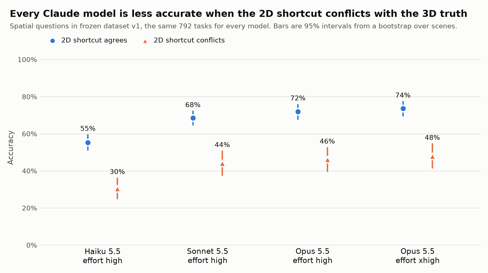

# Findings on frozen dataset v1: do Claude models take the 2D shortcut?

Generated by `scripts/shortcut_findings.py` from the model sweep of brief 06. Every model answered the same 1567 tasks (the 1,500-task evaluation sample plus the 150 blind-audit tasks) from frozen v1 (300 scenes, 3,181 tasks), with only the image and the question, through the Anthropic API: same prompts, same JSON schema, same scorer; only the model ID and effort differ. 792 of the tasks are spatial questions that carry the shortcut_conflict flag. Intervals are 95%, from a bootstrap that resamples whole scenes (261 scenes; a G6 twin counts with the scene it was made from; 2000 resamples), because tasks from one scene are correlated.

## Headline

- Haiku 5.5 at effort high: 55% when the 2D shortcut agrees with the 3D truth, 30% when it conflicts; gap 25 points (95% CI 18 to 32).
- Sonnet 5.5 at effort high: 68% when the 2D shortcut agrees with the 3D truth, 44% when it conflicts; gap 24 points (95% CI 17 to 32).
- Opus 5.5 at effort high: 72% when the 2D shortcut agrees with the 3D truth, 46% when it conflicts; gap 26 points (95% CI 18 to 33).
- Opus 5.5 at effort xhigh: 74% when the 2D shortcut agrees with the 3D truth, 48% when it conflicts; gap 26 points (95% CI 19 to 33).
- Shortcut capture: of the conflict tasks each model got wrong, the share answered with exactly the 2D-shortcut answer, against chance: Haiku 5.5 high 44% vs 46% (0.95x, 95% CI 0.79 to 1.12); Sonnet 5.5 high 64% vs 46% (1.39x, 95% CI 1.18 to 1.67); Opus 5.5 high 67% vs 49% (1.36x, 95% CI 1.12 to 1.67); Opus 5.5 xhigh 68% vs 46% (1.48x, 95% CI 1.21 to 1.84).
- The pull is strongest for 'nearest to the gripper', where wrong answers name the object nearest in the image: Haiku 5.5 high 12 of 38 (chance 21%); Sonnet 5.5 high 22 of 32 (chance 19%); Opus 5.5 high 23 of 31 (chance 17%); Opus 5.5 xhigh 22 of 27 (chance 17%). Other object families, all models pooled: relation 28 of 134 (chance 24%); occlusion 7 of 32 (chance 36%); reachability 20 of 30 (chance 10%).
- Confound check: the gap survives for every model. Within the same family and camera, conflict tasks score lower by (points): Haiku 5.5 high -26, Sonnet 5.5 high -25, Opus 5.5 high -28, Opus 5.5 xhigh -28; the logistic regression holding visible fraction, G4 margin, object count, camera quality and family fixed gives conflict odds ratios of Haiku 5.5 high 0.275 (0.188 to 0.403), Sonnet 5.5 high 0.289 (0.197 to 0.424), Opus 5.5 high 0.244 (0.163 to 0.366), Opus 5.5 xhigh 0.221 (0.15 to 0.326).
- More thinking (Opus 5.5 xhigh vs high): the gap changes by +0 points (95% CI -5 to +5); accuracy on conflict tasks by +2 points (95% CI -3 to +7).

## 1. Accuracy

| Model · effort | Overall | Shortcut agrees | Shortcut conflicts | Non-spatial | Front | Overhead | Wrist |
| --- | --- | --- | --- | --- | --- | --- | --- |
| Haiku 5.5 high | 50.3% (48–53) | 55.2% (51–59) | 30.3% (25–36) | 52.8% (49–56) | 49.4% (46–54) | 44.9% (41–49) | 57.4% (53–62) |
| Sonnet 5.5 high | 61.6% (59–64) | 68.5% (65–72) | 44.0% (38–51) | 61.9% (58–65) | 64.0% (60–68) | 54.3% (50–58) | 66.8% (62–72) |
| Opus 5.5 high | 65.5% (63–68) | 71.9% (68–76) | 46.2% (40–52) | 66.7% (63–70) | 67.0% (63–71) | 62.5% (58–67) | 67.0% (63–72) |
| Opus 5.5 xhigh | 66.4% (64–69) | 73.7% (70–77) | 47.9% (42–55) | 66.7% (63–70) | 68.8% (65–73) | 62.6% (58–67) | 67.7% (63–72) |

Tasks per model: 558 where the shortcut agrees, 234 where it conflicts, 775 non-spatial (counts, colours, distances, support, containment, gripper view).

By family:

| Family | Haiku 5.5 high | Sonnet 5.5 high | Opus 5.5 high | Opus 5.5 xhigh |
| --- | --- | --- | --- | --- |
| containment | 52.3% (44–61) | 59.7% (51–68) | 63.8% (55–71) | 63.1% (55–71) |
| count | 63.6% (55–72) | 76.2% (69–83) | 80.1% (73–87) | 75.5% (68–83) |
| count by colour | 69.9% (62–78) | 74.4% (67–81) | 72.4% (65–80) | 72.4% (65–80) |
| distance | 16.1% (10–23) | 25.8% (18–34) | 50.8% (42–60) | 54.8% (46–63) |
| free space | 68.9% (61–76) | 71.6% (64–79) | 72.3% (65–79) | 76.3% (70–83) |
| front to back | 74.5% (68–81) | 85.0% (79–91) | 88.9% (84–93) | 92.8% (89–96) |
| gripper view | 44.9% (31–58) | 63.3% (49–77) | 59.2% (44–73) | 61.2% (47–74) |
| nearest to gripper | 26.5% (18–35) | 45.7% (37–54) | 46.4% (37–56) | 49.0% (40–58) |
| occlusion | 27.3% (18–37) | 46.8% (37–58) | 51.9% (41–63) | 51.9% (41–64) |
| reachability | 46.4% (37–56) | 59.1% (50–68) | 60.9% (51–70) | 60.9% (52–70) |
| relation | 33.3% (26–41) | 51.6% (44–60) | 58.2% (51–66) | 56.9% (49–65) |
| support | 57.5% (49–66) | 66.4% (58–74) | 65.8% (57–74) | 67.1% (58–75) |

Spatial families, shortcut agrees / conflicts:

| Family | Haiku 5.5 high | Sonnet 5.5 high | Opus 5.5 high | Opus 5.5 xhigh |
| --- | --- | --- | --- | --- |
| free space | 79% / 46% (n 102 / 46) | 81% / 50% (n 102 / 46) | 85% / 43% (n 102 / 46) | 88% / 50% (n 102 / 46) |
| front to back | 82% / 57% (n 107 / 46) | 93% / 65% (n 107 / 46) | 95% / 74% (n 107 / 46) | 97% / 83% (n 107 / 46) |
| nearest to gripper | 36% / 2% (n 108 / 43) | 58% / 14% (n 108 / 43) | 58% / 16% (n 108 / 43) | 61% / 19% (n 108 / 43) |
| occlusion | 28% / 23% (n 64 / 13) | 47% / 46% (n 64 / 13) | 55% / 38% (n 64 / 13) | 58% / 23% (n 64 / 13) |
| reachability | 50% / 10% (n 100 / 10) | 63% / 20% (n 100 / 10) | 65% / 20% (n 100 / 10) | 65% / 20% (n 100 / 10) |
| relation | 42% / 25% (n 77 / 76) | 56% / 47% (n 77 / 76) | 64% / 53% (n 77 / 76) | 64% / 50% (n 77 / 76) |

## 2. Shortcut capture vs chance

Among conflict tasks a model got wrong with a readable answer, the share whose answer is exactly the 2D-shortcut answer, against the chance share (per task, 1 divided by the number of wrong answers on offer, averaged). Yes/no and two-object questions offer one wrong answer, so every miss there is the shortcut and the ratio is 1 by construction; the object-choice families (nearest to gripper, relation, occlusion) are the informative test.

| Model · effort | Scope | Conflict tasks | Answered misses | Shortcut picks | Share | Chance | Ratio (95% CI) |
| --- | --- | --- | --- | --- | --- | --- | --- |
| Haiku 5.5 high | all spatial | 234 | 154 | 67 | 44% | 46% | 0.949 (0.79–1.12) |
| Haiku 5.5 high | object choice | 132 | 100 | 22 | 22% | 25% | 0.898 (0.55–1.36) |
| Sonnet 5.5 high | all spatial | 234 | 118 | 76 | 64% | 46% | 1.388 (1.18–1.67) |
| Sonnet 5.5 high | object choice | 132 | 71 | 31 | 44% | 21% | 2.073 (1.33–3.20) |
| Opus 5.5 high | all spatial | 234 | 107 | 72 | 67% | 49% | 1.364 (1.12–1.67) |
| Opus 5.5 high | object choice | 132 | 62 | 30 | 48% | 23% | 2.107 (1.26–3.31) |
| Opus 5.5 xhigh | all spatial | 234 | 98 | 67 | 68% | 46% | 1.476 (1.21–1.84) |
| Opus 5.5 xhigh | object choice | 132 | 61 | 31 | 51% | 23% | 2.224 (1.40–3.51) |

By family (all models):

| Model · effort | free space | front to back | nearest to gripper | occlusion | reachability | relation |
| --- | --- | --- | --- | --- | --- | --- |
| Haiku 5.5 high | 25/25 vs 100% chance | 16/20 vs 100% chance | 12/38 vs 21% chance | 1/9 vs 26% chance | 4/9 vs 12% chance | 9/53 vs 27% chance |
| Sonnet 5.5 high | 23/23 vs 100% chance | 16/16 vs 100% chance | 22/32 vs 19% chance | 1/7 vs 34% chance | 6/8 vs 10% chance | 8/32 vs 21% chance |
| Opus 5.5 high | 26/26 vs 100% chance | 11/12 vs 100% chance | 23/31 vs 17% chance | 2/7 vs 41% chance | 5/7 vs 8% chance | 5/24 vs 26% chance |
| Opus 5.5 xhigh | 23/23 vs 100% chance | 8/8 vs 100% chance | 22/27 vs 17% chance | 3/9 vs 46% chance | 5/6 vs 8% chance | 6/25 vs 21% chance |

## 3. Confound check

Conflict tasks might simply be harder in other ways (more occluded, closer margins, busier scenes, worse cameras, harder families). Two checks:

- **Matched comparison:** conflict minus non-conflict accuracy inside each family x camera stratum that has both, averaged with each stratum's conflict-task count as weight.
- **Logistic regression** of correct on conflict, visible fraction, G4 margin (log of the margin over the gate threshold), object count, camera quality level (clean, mild, harsh, CCTV) and family, on the spatial tasks, with scene-clustered standard errors and a 500-fit scene bootstrap as a check. A second fit adds the camera.

| Model · effort | Matched gap, points (95% CI) | Strata | Odds ratio for conflict (clustered 95% CI) | Bootstrap 95% CI | With camera too | Stable | Survives |
| --- | --- | --- | --- | --- | --- | --- | --- |
| Haiku 5.5 high | -25.6 (-33 to -18) | 16 | 0.275 (0.188–0.403) | 0.183–0.394 | 0.266 (0.181–0.39) | yes | yes |
| Sonnet 5.5 high | -25.5 (-33 to -17) | 16 | 0.289 (0.197–0.424) | 0.19–0.408 | 0.264 (0.179–0.39) | yes | yes |
| Opus 5.5 high | -27.6 (-35 to -20) | 16 | 0.244 (0.163–0.366) | 0.154–0.36 | 0.225 (0.15–0.339) | yes | yes |
| Opus 5.5 xhigh | -27.5 (-35 to -20) | 16 | 0.221 (0.15–0.326) | 0.147–0.308 | 0.199 (0.134–0.295) | yes | yes |

Pooled fit over all models (model indicators added, n 3168 answers, 249 scenes): conflict odds ratio 0.259 (clustered 95% CI 0.191 to 0.351). Coefficients (log-odds; continuous covariates standardised):

| Term | Coefficient | Clustered SE |
| --- | --- | --- |
| intercept | +0.938 | 0.164 |
| conflict | -1.350 | 0.155 |
| visible_fraction_z | +0.185 | 0.076 |
| g4_margin_z | +0.144 | 0.097 |
| object_count_z | -0.061 | 0.066 |
| camera_quality_z | -0.142 | 0.065 |
| family=front_to_back | +0.904 | 0.214 |
| family=nearest_to_gripper | -1.509 | 0.212 |
| family=occlusion | -1.489 | 0.280 |
| family=reachability | -1.141 | 0.240 |
| family=relation | -1.083 | 0.265 |
| model=claude-sonnet-5-5 | +0.673 | 0.082 |
| model=claude-opus-5-5 | +0.831 | 0.102 |
| model=claude-opus-5-5-xhigh | +0.926 | 0.097 |

## 4. Does thinking help?

Differences use the same scene resamples for both models, so they are paired. Gap = accuracy where the shortcut agrees minus where it conflicts.

| Comparison | Gap change, points | Conflict accuracy change | Overall change |
| --- | --- | --- | --- |
| Opus 5.5 xhigh vs Opus 5.5 high | +0.1 (-5 to +5) | +1.7 (-3 to +7) | +0.9 (-1 to +2) |
| Opus 5.5 high vs Sonnet 5.5 high | +1.3 (-5 to +8) | +2.1 (-4 to +8) | +3.9 (+2 to +6) |
| Sonnet 5.5 high vs Haiku 5.5 high | -0.4 (-7 to +6) | +13.7 (+9 to +19) | +11.3 (+9 to +13) |
| Opus 5.5 high vs Haiku 5.5 high | +0.9 (-7 to +9) | +15.8 (+9 to +23) | +15.2 (+12 to +18) |

Mean thinking tokens per answer (output tokens the API reports as thinking):

| Model · effort | Shortcut agrees | Shortcut conflicts | Non-spatial |
| --- | --- | --- | --- |
| Haiku 5.5 high | 320 (n 558) | 375 (n 234) | 239 (n 775) |
| Sonnet 5.5 high | 129 (n 17) | 263 (n 21) | 124 (n 29) |
| Opus 5.5 high | 164 (n 558) | 251 (n 234) | 150 (n 775) |
| Opus 5.5 xhigh | 316 (n 558) | 550 (n 234) | 507 (n 775) |

## 5. Human comparison

Pending the founder's blind audit of the 150 audit tasks (all models answered them). When the export is in, `uv run python scripts/audit_vs_models.py --run out/v1 --answers <export.json>` scores it with the same scorer and writes human_vs_models.md beside this file.

## Cost

| Model · effort | Answers | Input tokens | Output tokens | of which thinking | Cost (USD) |
| --- | --- | --- | --- | --- | --- |
| Haiku 5.5 high | 1567 | 2,176,380 | 470,390 | 451,216 | 0.23 |
| Sonnet 5.5 high | 1567 | 2,176,380 | 275,613 | 11,335 | 6.96 |
| Opus 5.5 high | 1567 | 2,176,380 | 284,535 | 266,035 | 7.20 |
| Opus 5.5 xhigh | 1567 | 2,176,380 | 716,437 | 697,885 | 11.52 |

Batched answers bill at half the list price; Sonnet's first 1,500 answers were standard calls from 23 Nov.

## Method notes

- Settings on every call: thinking adaptive, effort set explicitly, max_tokens 16,000 (64,000 and a 1,200 s timeout at xhigh), structured JSON output, no sampling parameters; anthropic SDK 2.12.0, API version 2026-10-21. Each result records the model ID, API and SDK version, effort, max_tokens, input, output and thinking tokens, and whether it came from a standard call or the Message Batches API (same request body).
- A miss counts as a shortcut pick when the eval scorer accepts the answer against the task's shortcut_answer. 8 relation tasks name a shortcut object that is not nameable in that view; those are matched by noun.
- Unparseable answers count as wrong in accuracy and are left out of the capture share (they name nothing).
- Relation tasks with a single candidate have no runner-up and no finite G4 margin; the regression gives them the largest margin observed.
- The regression is fit by IRLS in numpy; it is called unstable if it fails to converge, a coefficient exceeds 15 in absolute value, or over 5% of bootstrap fits fail, in which case only the matched comparison is reported.
