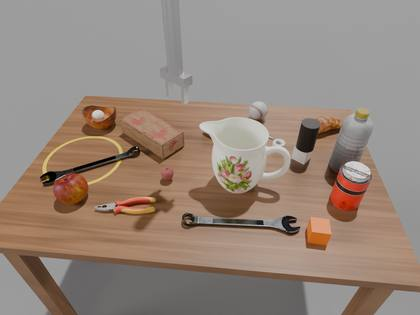
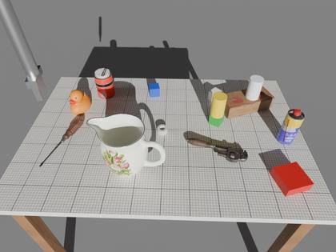
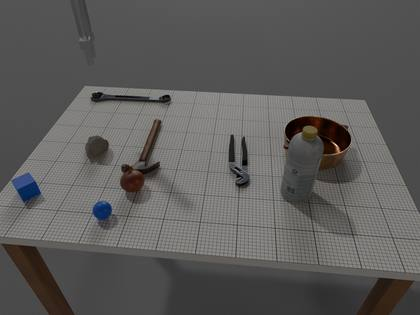
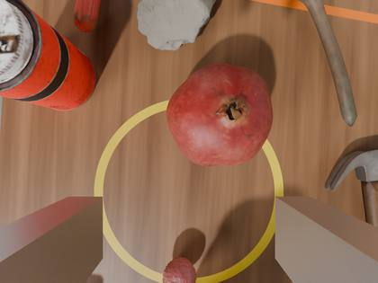
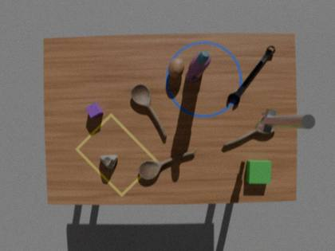
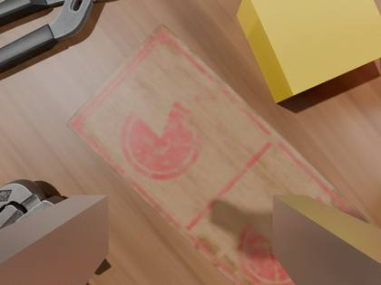
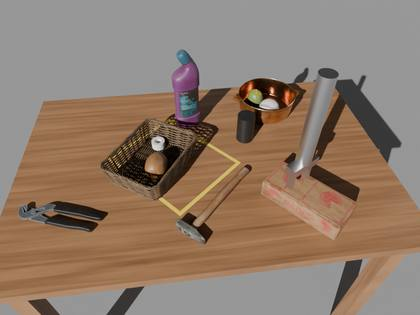
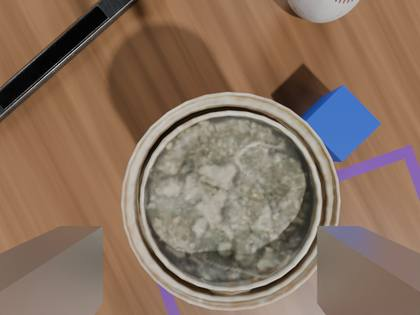

# Risk cards: Claude models on robot-workcell spatial questions

One column per model setting we tested, from frozen dataset v1 (300 scenes, 3,181 tasks; every model answered the same 1567 tasks with only the image and the question). Error types are counted by rules over the answers, not by hand. These cards speak only about the Claude models we tested.

| | **Haiku 5.5 high** | **Sonnet 5.5 high** | **Opus 5.5 high** | **Opus 5.5 xhigh** |
| --- | --- | --- | --- | --- |
| **Overall accuracy** | 50% | 62% | 65% | 66% |
| **Risk** | Unreliable spatial reading: wrong on 2D-shortcut conflicts, but its misses are spread rather than pulled to the shortcut | Answers from the 2D picture, not the 3D scene: picks the object that looks nearest or lowest in the image | Answers from the 2D picture, not the 3D scene: picks the object that looks nearest or lowest in the image | Answers from the 2D picture, not the 3D scene: picks the object that looks nearest or lowest in the image |
| **Severity** | high (shortcut), high (object not in the scene), high (count off by one) | high (shortcut), medium (object not in the scene), medium (count off by one) | high (shortcut), medium (object not in the scene), medium (count off by one) | high (shortcut), medium (object not in the scene), high (count off by one) |
| **Trigger conditions** | 2D shortcut conflicts with the 3D truth; evidence objects visible: 60–79% (-11 pts); objects on the table: 16–20 (-10 pts); distance questions (16% right); nearest to gripper questions (26% right) | 2D shortcut conflicts with the 3D truth; camera quality: harsh (-16 pts); evidence objects visible: 60–79% (-14 pts); distance questions (26% right); nearest to gripper questions (46% right) | 2D shortcut conflicts with the 3D truth; camera quality: harsh (-12 pts); evidence objects visible: under 60% (-12 pts); nearest to gripper questions (46% right); distance questions (51% right) | 2D shortcut conflicts with the 3D truth; camera quality: harsh (-13 pts); evidence objects visible: 60–79% (-13 pts); nearest to gripper questions (49% right); occlusion questions (52% right) |
| **Error type: 2D-shortcut answer (of conflict tasks)** | 29% (67 of 234) | 32% (76 of 234) | 31% (72 of 234) | 29% (67 of 234) |
| **Error type: names an object not in the scene (of object answers)** | 24% (238 of 988); 45% of its wrong object answers | 17% (171 of 988); 44% of its wrong object answers | 17% (171 of 988); 47% of its wrong object answers | 18% (181 of 988); 51% of its wrong object answers |
| **Error type: count off by one (of count tasks)** | 21% (64 of 307); 64 of 102 count misses | 18% (56 of 307); 56 of 76 count misses | 17% (53 of 307); 53 of 73 count misses | 20% (62 of 307); 62 of 80 count misses |
| **Counterfactual twin: sticks to the old answer** | 12% of pairs (both right 34%) | 11% of pairs (both right 46%) | 9% of pairs (both right 52%) | 10% of pairs (both right 50%) |
| **Example 1** |  *shortcut answer* · front camera Q: Which object is nearest to the gripper's tip? Truth: **jug** · Model: **box** · 2D shortcut: box |  *shortcut answer* · front camera Q: Which object is closest to the tip of the gripper? Truth: **jug** · Model: **rubber duck** · 2D shortcut: duck |  *shortcut answer* · front camera Q: Which object is nearest to the gripper's tip? Truth: **rock** · Model: **wrench** · 2D shortcut: wrench |  *shortcut answer* · gripper camera Q: Which object is closest to the tip of the gripper? Truth: **pomegranate** · Model: **lychee** · 2D shortcut: lychee |
| **Example 2** |  *object not in the scene* · overhead camera Q: From the camera's view, which object is the nearest one directly to the right of the kiwi? Truth: **bottle** · Model: **pink marker** |  *object not in the scene* · gripper camera Q: In the gripper camera's view, which object lies directly at the image centre? Truth: **box** · Model: **card** |  *object not in the scene* · front camera Q: From the camera's view, which object does the pot block from view the most? Truth: **baseball** · Model: **apple** |  *object not in the scene* · gripper camera Q: In the gripper camera's view, which object does the can block from view the most? Truth: **cube** · Model: **purple frame** |
| **Mitigation** | Keep it off spatial decisions: its misses are scattered rather than pulled to the shortcut (shortcut picks at 0.95x chance), so no single check fixes them. Use it for colour counts, where it is close to the best setting (70% vs 74%); route nearest, relation and distance questions to a larger model or to depth geometry. | Check every 'which object is nearest the gripper' answer against depth (a depth camera or a second view) before the gripper moves: 22 of its 32 misses there name the object nearest in the image. | Give it the cell's object list with the image (a real workcell knows its inventory): 47% of its wrong object answers name an object that is not on the table, mostly a real object misidentified (the pot called a bowl, the can a jar). | Do not pay for xhigh on spatial picks: on conflict tasks it thinks 550 vs 251 tokens at high, and the shortcut gap moves by +0 points. Spend the budget on sensing (depth, a second view) instead. |

**How the rules work.** *2D-shortcut answer*: on a task where a flat 2D heuristic (nearest in the image, lowest in the frame) disagrees with the 3D truth, the answer equals the heuristic's answer (the eval scorer, against the task's shortcut_answer). *Names an object not in the scene*: a wrong object or list answer names a kind of object that is nowhere in the scene file (all cameras, not only the visible ones); most are real objects misidentified (the pot called a bowl, the can a jar, the kiwi a potato), which a rule cannot tell from a pure invention; a few true synonyms the scorer lacks (stone, pitcher, ball for a baseball, toy animal) are not counted. *Count off by one*: a count answer exactly one away from the truth. *Severity*: each of these errors sends a gripper to the wrong object or acts on a wrong count, so severity follows frequency: high when the error hits at least 20% of the tasks at risk, medium from 5%, low below. *Trigger conditions*: the difficulty levels with the largest family-adjusted drop ([breaking points](findings.md#5-breaking-points)) and the model's two weakest families. *Sticks to the old answer*: on a [G6 twin](findings.md#6-counterfactual-twins), the model gives the answer that was true before the object moved.

Generated by `scripts/robustness_findings.py`; numbers in findings.json (risk_cards).
