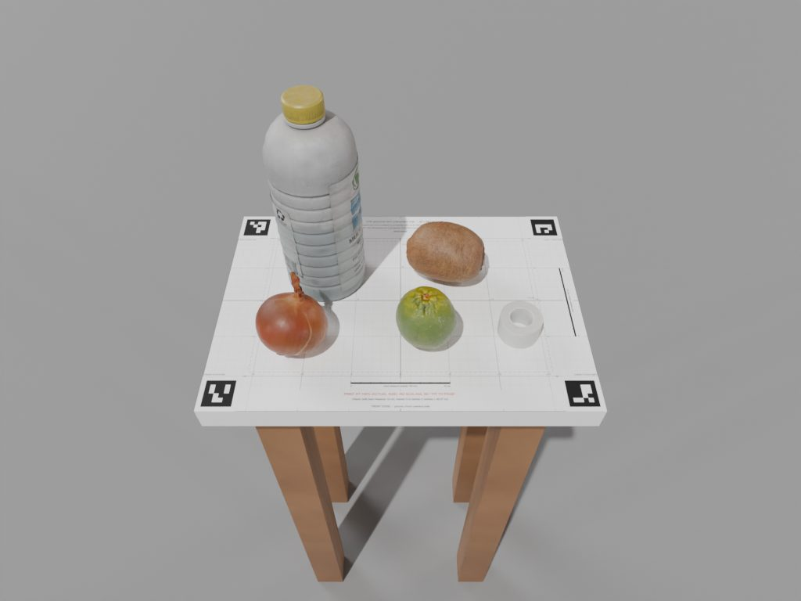
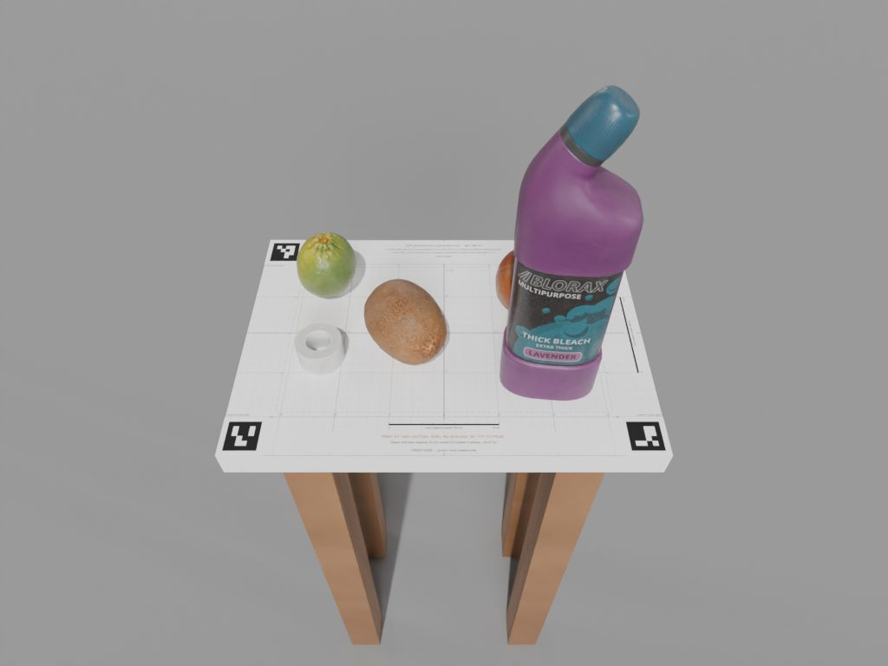
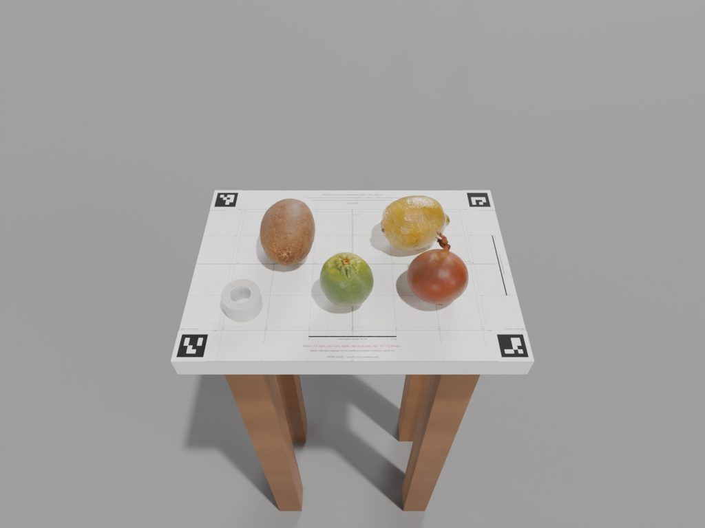

# Trap check: can a real photo show the 2D shortcut?

Brief VTF-08, Phase 1. The video needs a real photo on which Claude takes the 2D shortcut. Two things stood in the way: the physical set has no gripper, so the strongest trap on v1 (nearest to the gripper) cannot appear on a photo, and the 11 photo layouts hold about 3 objects each, so they give few conflict questions. This page checks what the existing layouts give, then builds three hero layouts that do show the trap, and names the one to film.

All questions here are on programs 0.3.0: distance and free-space questions open with "The table has a printed grid of 1 cm squares with bold lines every 10 cm." The 154 digital-twin tasks were re-validated on 0.3.0 before the models saw them: still 154 tasks, the same 8 conflict tasks.

## 1. Conflict tasks in the 154 digital-twin tasks

8 of 154 tasks are shortcut-conflict tasks (the 2D shortcut answer differs from the 3D truth). 34 more are spatial tasks where the shortcut agrees with the truth; 112 are not spatial.

| Family | Front | Overhead | Side | All |
| --- | --- | --- | --- | --- |
| relation | 1 | 2 | 3 | 6 |
| front_to_back | 0 | 2 | 0 | 2 |
| free_space, occlusion | 0 | 0 | 0 | 0 |
| **All** | **1** | **4** | **3** | **8** |

Only one conflict task is on the front spot, the natural camera for the video.

## 2. Sonnet 5.5 high and Opus 5.5 high on the 154 renders

| | All | Conflict | No conflict | Not spatial |
| --- | --- | --- | --- | --- |
| Sonnet 5.5 high | 137 of 154 (89.0%) | 7 of 8 | 32 of 34 | 98 of 112 |
| Opus 5.5 high | 140 of 154 (90.9%) | 7 of 8 | 33 of 34 | 100 of 112 |

Every conflict task where either model gave the shortcut answer: one. L01 (scene_0001), side spot, "From the camera's view, which object is the nearest one directly to the right of the bottle?" Truth: the onion. Both models answered the tape, the shortcut answer.

So 1 conflict task fooled both models, fewer than the 3 the brief asks for: hero layouts are needed. Batched answers, 0 errors, $0.92. Answers: out/twins_digital/trap_check/.

## 3. Hero layouts

**How they were made** (scripts/hero_layouts.py, recipes/hero_twin.yaml):

1. **Sample.** 400 seeds of the hero recipe: the 15 twin-pool assets on the mat, 5 to 7 objects, no duplicates (so every object can be named in a question), nothing in the bowl (bowl contents do not settle, see L08). 103 layouts fit on the 31 x 19 cm placement area with 1.5 cm gaps: 102 with 5 objects, 1 with 6. Seven never fit.
2. **Screen without Blender.** For each layout's front-spot digital twin, every free-space, front-to-back and relation question the programs accept on the exact mesh ray cast, and which of them are conflicts.
3. **Round 1.** The 10 layouts most likely to have a conflict asked, needing at most 2 new pieces: rendered as digital twins (all settled), validated (48 tasks, 21 conflict), asked to Sonnet and Opus. Both models gave the shortcut answer on 6 conflict tasks in 5 layouts.
4. **Round 2, clean traps.** The round-1 renders showed that most of those traps are ones a viewer could dispute: a free-space gap with a third object partly in it ("there is room beside it"), a relation answer just outside the 30-degree cone of "directly to the left", a front-to-back question where a tall bottle's raised centre is nearer the camera while its base sits behind. A clean trap is a free-space question decided by the gap itself, or front-to-back between objects under 12 cm tall. The 103 layouts hold 17 clean conflicts, all free space. The 12 layouts with one were rendered with those questions pinned (asked first, through every gate as usual): 15 of 16 passed the gates; both models fell for 1 of the 15 and got the other 14 right (Opus missed one more alone). The clean trap that works is a small item nearer the camera than the gap, so it looks wider than the gap; a tall tin or can that looks too big does not fool them.

In all: 20 layouts rendered, 97 tasks, 41 conflict tasks; both models gave the shortcut answer on 9 conflict tasks in 7 layouts. Answers: out/twins_hero_digital/trap_hero/ ($0.70).

**Kept**, each with at least one conflict question where both models give the shortcut answer:

| | Layout | Trap question (front spot) | Truth | Sonnet, Opus | New pieces |
| --- | --- | --- | --- | --- | --- |
| **H1** | hero_0297 | Is there room to place the tape on the table between the bottle and the lime? | **Yes.** Gap 6.9 cm, tape 4.5 cm, nothing in the way. The tape is nearer the camera, so it looks wider than the gap (62 px against 54 px). | No, no | none |
| H1 | hero_0297 | Would the kiwi fit on the table in the gap between the tape and the bottle? | **No.** The lime sits 2.7 cm into the 16 cm gap. | Yes, yes | |
| **H2** | hero_0062 | Is there room to place the tape on the table between the bottle and the lime? | **No.** The kiwi sits 3.5 cm into the 17 cm gap. | Yes, yes | purple bottle |
| **H3** | hero_0232 | Would the kiwi fit on the table in the gap between the tape and the lemon? | **No.** The lime sits 2.7 cm into the 16.5 cm gap. | Yes, yes | lemon |

H1 and H2 ask the same question with opposite truths, and both models get both wrong: on H1 they see no room where there is room, on H2 room where there is none.

Front-spot renders (the digital twins the photos are checked against):

| H1 (film) | H2 | H3 |
| --- | --- | --- |
|  |  |  |

**Not kept:** hero_0315, whose front-to-back trap rests on a tall bottle's raised centre (fair by the program's rule, wrong-looking on film) and whose free-space blocker is only 1.6 cm into the gap, within hand-placement error. hero_0244 and hero_0371, relation traps where the models' answer stands right beside the anchor, just outside the cone. hero_0394, which needs a rubber duck that Sonnet called orange while the questions call it yellow.

**In the photo guide and on the shopping list:**

- H1 to H3 come first in docs/twins/photo_session.md and .pdf, with sheets in docs/twins/hero_layouts.pdf. Front spot only, three photos each: on the spot, 3 cm left, 3 cm right. That makes 42 photos in all, about 70 minutes.
- Two new pieces, marked NEW on docs/twins/shopping_list.md: a lemon and a purple bottle. 8 kinds, 10 pieces in all.
- Each hero layout's trap questions are pinned (docs/twins/selection.json, hero.layouts[].pinned). `vtf twin register` writes them into the sibling run, so every hero photo asks them first rather than leaving them to the seeded draw of five.
- Dry run: the H1 render filed as H1_front_1.png and the H2 render under an anonymous name went through `vtf twin register`. Both passed G8, H1 was identified by name and H2 by its objects, and every pinned question was asked on its photo.

## 4. The layout to film

**H1 (hero_0297), front spot. Question: "Is there room to place the tape on the table between the bottle and the lime?"**

The answer is yes, nothing is in the way, and anyone can check it on the printed grid: a 6.9 cm gap, a 4.5 cm tape. Both Claude models say no because the tape, nearer the lens, looks bigger than the gap. It needs no new piece. If its photo does not fool the models, the next takes are H1's kiwi question, then H2 (the same question, the opposite truth).

Placement: the gap is 0.4 cm above the program's "yes" margin (gap at least the tape plus 2 cm). The guide asks for hero objects within half a centimetre. Even a centimetre off, the tape still physically fits.

## 5. Two endings (Phase 2)

Phase 2 runs all four Claude settings on the hero photos and their rendered siblings. One of two endings follows:

- **The failure is real.** On the real H1 photo the models still answer no, as on the render. The 2D shortcut survives the move from render to photo.
- **The factory measures the sim-to-real gap.** The models answer the photo differently from the render. The factory reports the difference per setting, with intervals.
